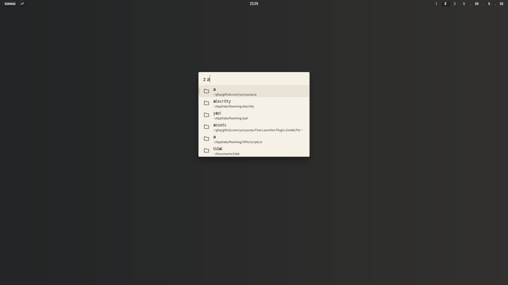
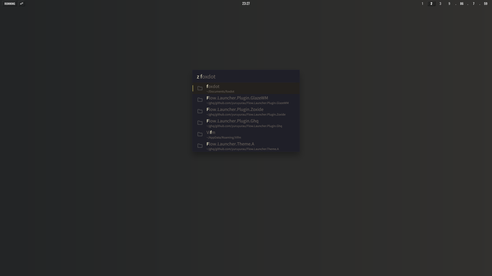

# Flow.Launcher.Plugin.Zoxide

A Flow Launcher plugin to search and open directories you've visited with
[zoxide](https://github.com/ajeetdsouza/zoxide).

## Preview

|              Light Theme              |             Dark Theme              |
| :-----------------------------------: | :---------------------------------: |
|  |  |

<sub>Using
[yuruyurau/Flow.Launcher.Theme.A](https://github.com/yuruyurau/Flow.Launcher.Theme.A)
for the preview.</sub>

## Usage

Type `z` followed by a search query: `z <query>`

- Filters by partial match (uses `zoxide query -l`).
- Supports multiple keywords (`z word1 word2`) — paths must contain all of them.
- `/` in the query is normalized to `\` before being passed to zoxide.
- Selecting a result opens the directory with the file manager configured in
  Flow Launcher (default: Explorer).

> [!NOTE]
>
> - Results are ordered by zoxide’s score (frequency + recency).
> - Paths are shortened for readability (`~` for user profile, `~msys` for MSYS2
>   home).
> - Opening a directory from this plugin does **not** update zoxide’s score.

## Prerequisites

- [zoxide](https://github.com/ajeetdsouza/zoxide) must be installed and
  available in your `PATH`.

If you have no history yet, teach zoxide some directories from your terminal:

```text
z <path>
# or
zoxide add <path>
```

## Installation

```text
pm install https://github.com/yuruyurau/Flow.Launcher.Plugin.Zoxide/releases/latest/download/Zoxide.zip
```

**Or manual installation:**

1. Download the latest release from
   [Releases](https://github.com/yuruyurau/Flow.Launcher.Plugin.Zoxide/releases).
2. Extract the zip to `%APPDATA%/FlowLauncher/Plugins/Zoxide/`.
3. Restart Flow Launcher.

## Credits

- [Flow Launcher](https://github.com/Flow-Launcher/Flow.Launcher)
- [zoxide](https://github.com/ajeetdsouza/zoxide)
- Assisted by [Grok](https://grok.com)
